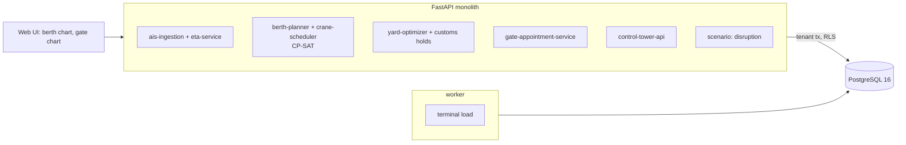

# Autonomous Port & Maritime Logistics Control Tower

For a container terminal's planners: it reads AIS to estimate when each vessel really arrives, plans berths and crane counts for the
day in one constraint model, stacks the yard so import boxes leaving together sit together, moves customs-held boxes out of the way,
spreads trucks into gate appointments, and shows the day on one screen with what each choice costs.

Built from blueprint 5 of "Advanced Engineering Build Book, Volume III" as a **vertical slice**: the demo scenario end to end,
with the platform parts real and the rest listed under [Not built](#not-built-and-why).

**The terminal, its vessels, containers, AIS and trucks come from a simulator in this repository. Crane rates, lane times and the yard
are stated assumptions. Zero planned rehandles is a property of the generator's exact pickup times.**

## Run it

```bash
docker compose up --build        # migrates, seeds, serves http://localhost:8215/ui/ with one worker
docker compose run --rm test     # 13 tests against a throwaway database (about 10 s)
```

Open http://localhost:8215/ui/ and press **Run all steps** (about 2 seconds), or `make bootstrap demo`.
Demo tokens (local only): `terminal-manager-demo`, `terminal-planner-demo`, `terminal-viewer-demo`. Run `make reset` before a second demo run.

## The demo, step by step

1. 10:00 at an invented terminal: three berths (300, 360 and 400 m), nine quay cranes, five vessels calling with 2,830 import boxes, 1,610 trucks expected. An arrival model trained on 320 past calls has an error of 8.9 minutes against 22.1 for distance over speed. The first berth plan is made on the schedule.
2. MSC Riverbend was due at 07:03. Her first AIS point arrives (sent twice; the copy is ignored): 60 nautical miles out at 14.4 knots. Predicted alongside 13:49, 406 minutes late, and that overlaps Maersk Prairie's slot at B2 by 229 minutes.
3. A what-if before changing anything: CMA Delta four hours later too. Keeping the plan: 103 minutes late beyond windows; re-planning: 4; first come, first served: 100.
4. Re-plan: a berth, a start and a crane count for every vessel. Expected lateness falls from 139 to 4 minutes; priority-weighted waiting rises from 1,435 to 1,713, because the objective weights lateness three times as heavily. Crane use peaks at nine and never above.
5. The yard: 2,830 boxes into 724 stacks with zero planned rehandles, against 2,079 if stacked in discharge order. Then 40 customs holds: left in place they would cost 62 rehandles; moved to the hold block, 40 moves now.
6. The gate: 1,610 trucks with two peaks over the 96-an-hour capacity. Without appointments the mean wait is 113 minutes and the queue peaks at 335 trucks; with appointments at 90% of capacity, 1.7 minutes and 33, with 438 trucks moved to a later hour.
7. Scored on the day's real arrivals, which the planner never saw: the plan before the AIS update would have run 139 minutes late beyond windows; the re-plan runs 15; first come, first served on the schedule 136. The re-plan also waits 274 more weighted minutes, as it was told to.

## Architecture



| Piece | How it works |
|---|---|
| Simulator (`pc/world.py`) | Five calls with schedule ETAs and hidden real arrivals (weather and congestion, plus the demo's four-hour delay); an AIS track consistent with each arrival; import boxes with a mode and a pickup time; hourly truck arrivals with two peaks. |
| Arrival model | Gradient-boosted trees (median loss) on AIS distance and speed, the gap to the schedule and the queue; trained on past calls, tested on held-out ones. |
| Berth and cranes | CP-SAT: one optional interval per (vessel, berth, crane count), no overlap per berth, a cumulative constraint capping cranes at nine, the berth long and deep enough; minimise priority-weighted waiting plus three times the minutes a vessel finishes after its window. Locks pin a vessel to a berth. First come, first served with three cranes each is kept beside it. |
| Yard | Boxes with the same mode and six-hour pickup window share a stack, latest pickup at the bottom; a rehandle is a box stacked on one that leaves earlier. Held boxes go to block H; the cost of leaving them is counted. |
| Gate | A fluid queue hour by hour against four lanes at 2.5 minutes a truck; appointments cap each hour at a share of capacity and carry the overflow forward. |
| Platform | Row-level security per operator, Postgres job queue, Idempotency-Key replay, hash-chained audit log, `/metrics`. |

## Data model

`migrations/002_port.sql` follows the blueprint (vessels, port_calls, berths, berth_allocations, containers, container_moves, yard_slots);
additions are marked `(+)`: terminals (the clock), ais_positions, gate_hours, plans, and on each call its prediction, moves and priority.

## API

| Method | Endpoint | Purpose |
|---|---|---|
| POST | `/v1/ais/positions` | AIS points; a resend stores nothing; a new estimate and a conflict check |
| POST | `/v1/planning/berths` | Berth, start and cranes for every vessel (CP-SAT), with locks |
| POST | `/v1/planning/cranes` | The crane schedule the plan implies |
| POST | `/v1/planning/yard` | Stack the yard; customs holds to block H |
| POST | `/v1/gate/appointments` | Appointments and the queue before and after |
| GET | `/v1/control-tower/status` | The day on one screen |
| POST | `/v1/scenarios/disruption` | What if a vessel were hours later |
| POST | `/v1/terminal:load` | (+) 202 + job: load a synthetic terminal |

Contract: [`docs/openapi.json`](docs/openapi.json).

## Measured

[`docs/evaluation.md`](docs/evaluation.md) (`python -m pc.evaluate`, three terminals and 18 days the demo never uses) and
[`docs/performance.md`](docs/performance.md).

| Component | Result | Baseline |
|---|---|---|
| Arrival estimate error | 7.7 to 8.6 min | distance over speed: 22 to 25 min |
| Priority-weighted waiting, a day | 1,824 min | first come: 2,623; perfect knowledge of arrivals: 1,721 |
| Late beyond windows, a day | 48 min | first come: 324; perfect: 27 |
| Crane utilisation | 81% | first come: 69% |
| Planned rehandles, 2,863 boxes | 0 | discharge order: 2,074 |
| Gate wait with appointments | 0.4 min | without: 93.5 min |

Three things these numbers say plainly. The berth planner's gain is real and comes mostly from giving big ships four cranes and
small ones two rather than three each; estimates cost it about 100 weighted minutes a day against perfect knowledge. Zero
rehandles describes the generator, whose pickup times are exact; real appointments slip. And appointments do not make a gate faster,
they move trucks to hours with room, and the fluid queue is the best case for a gate that runs to them.

## The hardest tradeoff

Lateness against waiting. The first objective counted only waiting minutes, and the planner happily let a low-priority feeder
finish hours past its window if that shaved waiting off the others. Adding a late penalty three times the waiting weight made the
plans the terminal would want; it also means the re-plan in the demo waits 274 weighted minutes more than keeping the broken plan
would, in exchange for finishing 124 minutes less late. The replay says so. The weights are two named constants, and a terminal
whose carriers care more about berthing on arrival than about departure windows would swap them.

## Threat model (summary)

| Threat | Mitigation here | Gap |
|---|---|---|
| A spoofed or replayed AIS point | Only the terminal's own vessels, inside the day up to the clock; a resend stores nothing; Idempotency-Key replay returns the stored response | No source authentication |
| A plan that breaks a physical rule | Length, depth and crane capacity are hard constraints; the crane schedule reports if it is ever over nine | Tides and pilot availability are not modelled |
| Silently changing a plan | Every plan is a row with its author and numbers; the audit chain records it | No approval step before a plan is published |
| One terminal seeing another's calls | Row-level security on every table; tested through the API and directly in the database | |

## Not built, and why

- **Real AIS, TOS and customs adapters**: positions arrive as JSON; the day is generated. The service rebuilds the day's truth from the generator's seed for the replay.
- **Rail planning and an event stream**: not started.
- **Yard occupancy over time**: the yard is empty at the start and boxes are not removed as they leave; rehandles are planned counts.
- **Weather and tide in the ETA model**: the generator has neither.
- **Crane productivity that varies, crane moves along the quay, labour shifts**: a crane does 28 moves an hour, always.
- **Kafka, Redis, OpenTelemetry, Grafana, MLflow, Terraform, CI, SSO, a Next.js front end**: not needed to prove the slice; no cloud account used.

## Commercial sketch

Buyer: terminal operators and port authorities. Pricing shape from the blueprint: a terminal-wide annual licence with optimisation
modules priced separately and a usage-based API for carriers.

## Layout

```
core/        platform kit: db + RLS, jobs, audit chain, HTTP, scenario runner, load test
pc/          world (calls, AIS, boxes, trucks), engine (ETA, berths and cranes, yard, gate), api, seed, evaluate
migrations/  forward-only SQL          web/   UI, scenario.json, demo.json (recorded run)
tests/       13 tests                  docs/  evaluation.md, performance.md, openapi.json
```
